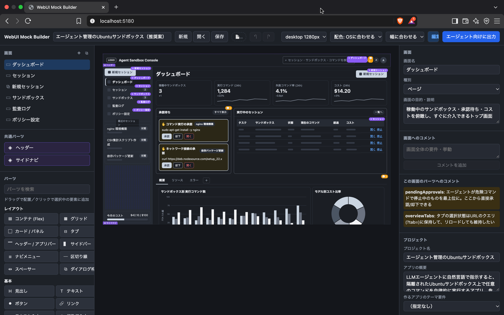
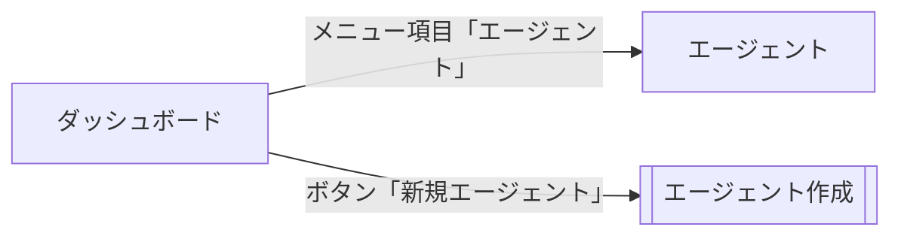

# WebUI Mock Builder

コーディングエージェントに渡す「UIの意図」を、ドラッグ＆ドロップで作るワイヤーフレームツールです。

設計書の文章だけを渡すと、エージェントが作る画面は想定とずれがちです。このツールでは、部品の配置・入れ子・画面遷移・コメントを画面上で組み立て、エージェントが読みやすい Markdown / JSON として出力します。



> A drag-and-drop wireframe builder that exports UI intent (layout tree, screen transitions, comments) as Markdown / JSON for coding agents, with an MCP server so agents can propose and read screens. The UI and documentation are in Japanese.

## 特徴

- **ドラッグ＆ドロップで配置** — Flex / Grid のコンテナに約40種類の部品を入れ子で配置できます。
- **動くワイヤーフレーム** — タブの切り替え、画面遷移、モーダルをプレビューで実際に操作できます。
- **エージェント向けの出力** — レイアウトツリー、画面遷移図（mermaid）、コメントを1つの Markdown にまとめます。色や装飾を含まないので、出力は小さく収まります。
- **コメント** — 画面や部品に意図を書き込めます。出力では最優先の要件として扱われます。
- **共通パーツ** — ヘッダーやサイドバーを1回だけ定義し、複数の画面で使い回せます。
- **MCP 連携** — コーディングエージェントが画面案を書き込み、人がビルダーで直した結果を読み取れます。
- **部品を追加しやすい** — 部品は1つの定義オブジェクトで、右パネルの入力欄も自動で作られます。

最初の部品セットは、複数のLLMエージェントが動くアプリの管理画面を想定しています。

| 分類 | 部品 |
|---|---|
| レイアウト | コンテナ (Flex)、グリッド、カード、タブ、ヘッダー、サイドバー、ナビメニュー、区切り線、スペーサー、ダイアログ枠 |
| 基本 | 見出し、テキスト、ボタン、リンク、テキスト入力、複数行入力、セレクト、チェック / トグル、ラジオ / セグメント、バッジ、アイコン、画像、アバター |
| データ表示 | グラフ（折れ線・棒・面・散布図・円・ドーナツ）、テーブル、KPIタイル、リスト、キー・値リスト、進捗バー、ログビューア |
| LLMエージェント | チャット、チャット入力欄、エージェントカード、タスクボード、実行タイムライン、思考ログ、ワークフロー図、承認リクエスト、トークン / コストメーター |

## はじめかた

Node.js 20 以上が必要です。

```bash
git clone https://github.com/aWtlcm9h/WebUIMockBuilder.git
cd WebUIMockBuilder
npm install
npm run dev
```

ブラウザで http://localhost:5180 を開きます。初回は、マルチエージェント管理画面のサンプルが読み込まれた状態で始まります。空の状態から始めるときは、ツールバーの「新規」を押します。

作業の流れは次のとおりです。

1. 左のパレットから部品をキャンバスへドラッグして、画面を組み立てます。
2. 部品を選び、右パネルで内容・サイズ・遷移先を設定します。伝えたい意図はコメントに書きます。
3. 「プレビュー」で、タブや画面遷移の動きを確かめます。
4. 「エージェント向けに出力」で Markdown を出力し、コーディングエージェントに渡します。

編集内容はブラウザに自動保存されます。ファイルとして残すときは「保存」を使います。

## 操作方法

| 操作 | 方法 |
|---|---|
| 部品の配置 | 左パレットからキャンバスへドラッグ。クリックすると、選択中の要素の中または後ろに追加される |
| 移動 | キャンバス上の要素をドラッグ。コンテナの端（6px）にドロップすると、外側の親コンテナに入る |
| 選択 | クリック。右パネルのパンくずで親を選べる。`Esc` で親へ移る |
| 削除・複製 | `Delete` / `⌘D`（Windows / Linux は `Ctrl+D`）。右パネルにもボタンがある |
| 元に戻す・やり直す | `⌘Z` / `⌘⇧Z`（Windows / Linux は `Ctrl+Z` / `Ctrl+Shift+Z`） |
| タブ | ダブルクリックで名前を変更、`＋` で追加、`×` で削除。タブをクリックすると、その中身を編集できる |
| 画面遷移 | 要素を選び、右パネルの「クリック時の遷移先」で画面を選ぶ。プレビューで実際に遷移する |
| モーダル | 画面一覧の `⧉` でモーダル画面を追加する。遷移先に指定すると、前の画面に重ねて表示される。閉じるボタンには遷移先「閉じる」を指定する |
| 共通パーツ | 要素を選び、右パネルの「◈ 共通パーツにする」で登録する。左の「共通パーツ」からドラッグして他の画面に配置する。1回目のクリックで全体、もう一度クリックすると中の要素を選べる。中身の変更は全画面に反映される。「この場所だけ解除」で独立したコピーに戻せる |
| コメント | 要素を選び、右パネルで追加する。画面単位のコメントも書ける |
| 配色 | ツールバーの「配色」で、ライト / ダーク / OSに合わせる、から選ぶ。ビルダーの表示だけの設定で、保存ファイルや出力には影響しない |
| テーマ要件 | 何も選択していないときの右パネル「作るアプリのテーマ要件」で、作るアプリがダークモードに対応すべきかを指定する。出力に書かれる |
| 保存・開く | 「保存」で `*.uimock.json` をダウンロードする。「開く」で読み込む |

## エージェントへの渡し方

「エージェント向けに出力」から、次の2種類を出力できます。

- **Markdown（推奨）** `*.ui-spec.md`
  読み方のルール、画面一覧、画面遷移図、共通パーツの定義、画面ごとのレイアウトツリー、コメントをまとめたものです。設計書と一緒にプロンプトへ貼るか、リポジトリに置いて参照させます。
- **コンパクトJSON** `*.ui-spec.json`
  初期値と同じプロパティを省いた構造データです。省いた値は、同じファイル内の `partDefaults`（部品の種類ごとの初期値）で補えます。厳密な構造を参照させたいときに使います。

Markdown は次のような形になります（サンプルプロジェクトの出力の一部）。

````markdown
## 画面遷移


## S1: ダッシュボード
- Flexコンテナ（縦並び, gap 0px, padding 0px） [幅:fill, 高さ:fill]
  - 共通パーツ C1「ヘッダー」を配置（中身は「共通パーツ」の節を参照） [幅:fill]
  - Flexコンテナ（横並び, gap 0px, padding 0px） [高さ:fill]
    - 共通パーツ C2「サイドバー」を配置（中身は「共通パーツ」の節を参照） [幅:240px, 高さ:fill]
    - Flexコンテナ（縦並び, gap 12px, padding 16px） [幅:fill]
      - `#kpiRow` Grid（4列, gap 12px）
        - KPIタイル「稼働中エージェント」値例 5（+2）
      - `#overviewTabs` タブ（3枚, 位置: 上, 見た目: line）。クリックで下のパネルを切替 [幅:fill]
        - 💬 **タブの選択状態はURLのクエリ(?tab=)に保持して、リロードしても維持したい**
````

エージェントへの指示の例:

> `docs/ui-spec.md` のレイアウトツリーと💬コメントに従って画面を実装して。部品の種類と配置は変えないこと。

## コーディングエージェントとの連携（MCP）

[MCP](https://modelcontextprotocol.io/) に対応したコーディングエージェントから、このツールのプロジェクトファイル（`*.uimock.json`）を直接読み書きできます。エージェントが設計の段階で画面案を書き、人がビルダーで直し、その結果をエージェントが読んで実装する、という往復ができます。

```
コーディングエージェント ⇄ MCP サーバー ⇄ *.uimock.json ⇄ 開発サーバー ⇄ ビルダー（ブラウザ）
```

### 1. エージェントに MCP サーバーを登録する

Claude Code の場合は、エージェントを使うプロジェクトの直下に `.mcp.json` を置きます。`command` には、このリポジトリを置いた場所の `mcp/start.sh` を絶対パスで書きます。

```json
{
  "mcpServers": {
    "webui-mock": {
      "command": "/path/to/WebUIMockBuilder/mcp/start.sh",
      "env": { "UIMOCK_FILE": "docs/ui.uimock.json" }
    }
  }
}
```

コマンドで登録することもできます。

```bash
claude mcp add --env UIMOCK_FILE=docs/ui.uimock.json webui-mock -- /path/to/WebUIMockBuilder/mcp/start.sh
```

| 環境変数 | 内容 |
|---|---|
| `UIMOCK_FILE` | 既定のプロジェクトファイル。相対パスは、エージェントの作業フォルダから解決される。ファイルがなければ、最初の書き込みで作られる |
| `NODE_BIN_DIR` | `node` のあるフォルダ。エージェントが `node` を見つけられないときに指定する |

ほかのエージェントでも、標準入出力（stdio）で `mcp/start.sh` を起動するよう設定すれば使えます。起動スクリプトはシェルスクリプトなので、Windows では WSL などの環境が必要です。

エージェントが使える道具は次のとおりです。

| 道具 | 内容 |
|---|---|
| `get_part_catalog` | 使える部品と props、ツリーの書き方を返す |
| `get_project` | 現在の画面を読む（Markdown または JSON）。人の編集結果も含む |
| `write_screens` | 画面・共通パーツを作成または置き換える。誤りがあれば何も書かずに直し方を返す |
| `delete_items` | 画面・共通パーツを削除する |
| `update_project` | プロジェクト名、概要、画面幅、テーマ要件を更新する |
| `add_comment` | 画面や部品にコメント（質問や意図の説明）を追加する |

### 2. ビルダーで同じファイルを開く

同じファイルをビルダーで開くと、双方向に同期します。エージェントの書き込みは1〜2秒で画面に反映され、ビルダーでの編集はファイルに自動保存されます。開き方は3つあります。

- ツールバーの「📄 ファイル連携」を押して、ファイルのパスを入力する
- URL で指定する: `http://localhost:5180/?file=/path/to/docs/ui.uimock.json`
- 起動時に指定する: `UIMOCK_FILE=/path/to/docs/ui.uimock.json npm run dev`

ファイル連携は開発サーバー（`npm run dev`）でだけ動きます。対象は名前が `.uimock.json` で終わるファイルに限られ、接続できるのは同じマシンのブラウザだけです。

### 同時に編集したとき

ロックやマージはありません。モックは作り直しやすいものなので、「先にファイルへ書かれた内容が勝ち、負けた側は元に戻せる」という単純な方針にしています。

- エージェントの書き込みは、人の編集を上書きします。
- ビルダーは保存するとき、最後に読んだ版からファイルが変わっていないかを確かめます。変わっていたら保存をやめ、ファイルの内容を読み込みます。
- 外部の変更を読み込むと、画面下に通知が出ます。「元に戻す」で読み込む前の状態に戻せます。その場合は、戻した内容がファイルに保存されます。
- エージェントには、前回読み書きしたあとで人が編集した画面を、書き込みの結果で知らせます。書き込み自体は止めません。

## 部品の追加方法

1. `src/parts/` に、`PartDef` の配列をエクスポートするファイルを作ります（例: `src/parts/ecommerce.tsx`）。
2. `src/parts/index.ts` の `registerParts([...])` に追加します。

```tsx
import type { PartDef } from './types';

export const myParts: PartDef[] = [{
  type: 'priceTag',                 // 一意なID（保存ファイルに記録される）
  label: '価格表示', category: 'EC', icon: '¥',
  fields: [{ key: 'price', label: '価格', kind: 'text' }],  // 右パネルの入力欄が自動で作られる
  defaultProps: { price: '¥1,980' },
  render: ({ props }) => <span className="wf-chip">{String(props.price)}</span>,
  describe: (p) => `価格表示（例 ${p.price}）`,             // エージェント向けの1行説明
  // container: true にすると子要素を受け入れる。render の中で ctx.renderChildren() を使う
}];
```

`fields` の `kind` には `text` / `textarea` / `number` / `boolean` / `select` / `list` を指定できます。追加した部品は、パレット、出力、MCP の部品カタログに自動で反映されます。

## 開発

```bash
npm run dev        # 開発サーバー（http://localhost:5180）
npm test           # 単体テスト
npm run typecheck  # 型チェック
npm run build      # 本番ビルド（dist/）
```

React 18、TypeScript、Vite、Zustand で作られています。

```
src/
  model/    types.ts（保存形式）, store.ts（状態・Undo）, tree.ts, components.ts（共通パーツ）,
            validate.ts（読み込み検査）, fileSync.ts（ファイル同期）, diff.ts（変更の要約）, sample.ts
  parts/    registry.ts, layout / basic / data / agent（部品の定義）
  editor/   Canvas（ドラッグ＆ドロップ）, LeftPanel（画面・パレット）, PropertiesPanel, Toolbar
  export/   agentSpec.ts（Markdown / JSON 出力）, importSpec.ts（JSON の取り込み）,
            catalog.ts（部品カタログ）, io.ts
mcp/        server.ts（MCP サーバー）, projectFile.ts（ファイル読み書き）, start.sh（起動スクリプト）
```

## 制限事項

- ワイヤーフレーム専用です。色、フォント、細かな余白などの見た目は指定できません。
- 画面の表示は日本語だけです。
- ファイル連携と MCP は、ローカルの開発サーバーでの利用を前提にしています。本番ビルド（`dist/`）を静的に配信した場合、ファイル連携は使えません。
- 共通パーツの中に、別の共通パーツは入れられません。

## ライセンス

[MIT License](LICENSE)
